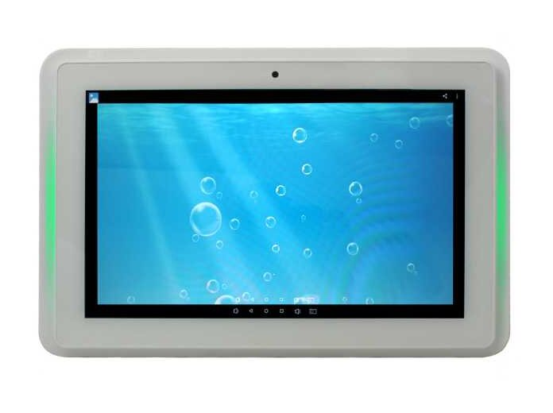
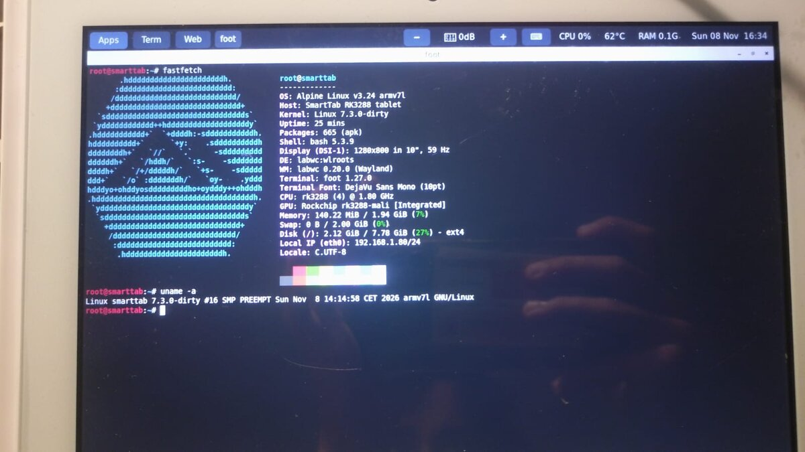
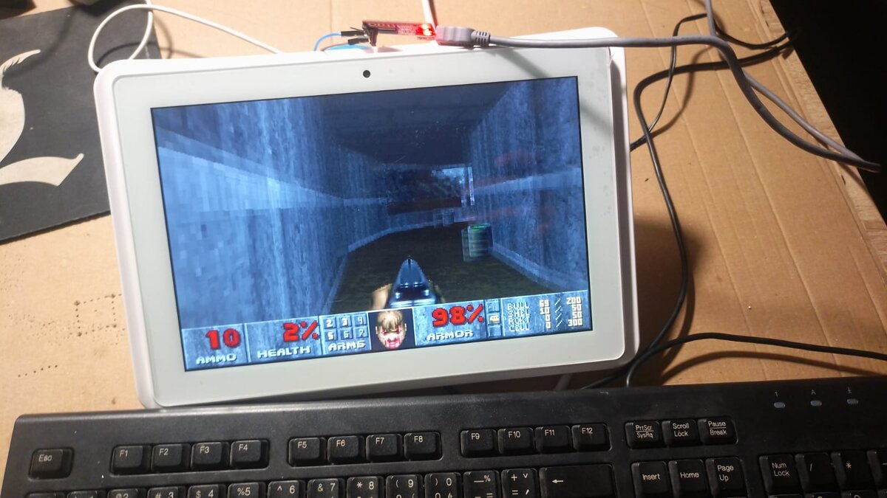
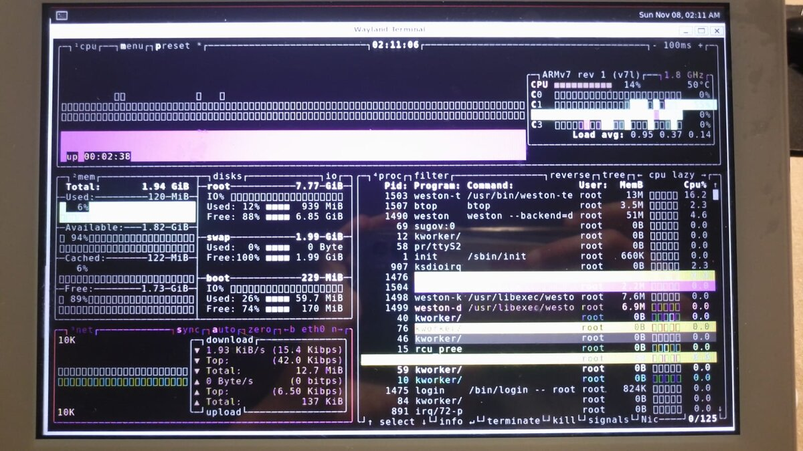

# ALLNET Design LED Tablet 10 Inch RK3288

**Device name in this repo: SmartTab**, a wall-mounted meeting-room tablet with RGB LED bars, PoE and NFC.

  
   Stock photo: <a href="https://www.allnet.de/en/allnet-brand/produkte/displaysdigital-signage/meetingroom-tablets/p/allnet-design-led-tablet-10-zoll-rk3288-android-81-und-nfc-meetingraum-tablet/">ALLNET product page</a>

  
  
  
   My photos: mainline Linux 7.3 + Alpine in a labwc desktop · Doom · btop, 4 cores at 1.8 GHz

| | |
|---|---|
| SoC | Rockchip RK3288 (4× Cortex-A17 @ 1.8 GHz, Mali-T760 GPU) |
| Memory | 2 GB RAM, 16 GB eMMC |
| Display | 10", 800×1280 MIPI-DSI, 10-point touch |
| Connectivity | gigabit Ethernet with PoE, WiFi + Bluetooth (AP6212), NFC |
| Stock firmware | Android 8.1, bootloader locked |

More in [`hardware/HARDWARE.md`](hardware/HARDWARE.md).

## What I achieved

Starting from a **locked Android tablet**, without unlocking anything and without modifying the vendor's
start-up code:

- **Root access and a full copy of the storage** through a poorly secured Android recovery
- **Reverse-engineered the bootloader's image check** in Ghidra and reproduced it, so the stock
  bootloader accepts my own images
- **Flashed and booted my own U-Boot**, started by the vendor bootloader
- **Ported mainline Linux** with Alpine on the internal storage: screen, touch, Ethernet, WiFi/Bluetooth,
  USB, audio, GPU, thermal management, and a small desktop

## The story in short

1. **[Opening it up](docs/01-uart.md).** Before ever turning the tablet on, I found a serial port (UART)
   on the board and soldered wires to it. It showed the full boot log, but ignored anything I typed.
2. **[Android recovery](docs/02-android-recovery-adb-dump.md).** Holding the recovery button at power-on
   starts Android's recovery mode. It was poorly secured: I could get a root shell over USB (adb) and
   copy the entire internal storage to my PC.
3. **[Ghidra](docs/03-uboot-image-hash.md).** Studying the bootloader from that copy, I found it only
   boots images whose header contains the right checksum. The checksum needs no secret key, so I could
   compute it for my own images.
4. **[Loader mode](docs/04-loader-mode.md).** The chip is a Rockchip, and a shorter press of the same
   button puts it into Rockchip's USB flashing mode, which needs no password. Now I could write images
   to the storage.
5. **[My own bootloader](docs/05-chainload-uboot.md).** I flashed a modern U-Boot packed as a boot image
   with a valid checksum. The vendor bootloader starts it like it would start Android.
6. **[Linux](docs/06-mainline-linux.md).** From there it was a normal board port: mainline Linux and
   Alpine on the internal storage.

[Appendix: trying to make the UART accept input](docs/appendix-uart-input.md)

## What made it possible

- **The bootloader checks images for damage, not for who made them.** Its checksum uses no secret key,
  so a valid one can be computed for any image.
- **The USB flashing mode is open.** A button press enters it, and it asks for no password.
- **Mistakes could always be undone.** The flashing mode belongs to vendor code I never touched, so it
  kept working no matter what I flashed.
- **I didn't replace the vendor bootloader, I let it start mine.** It doesn't check whether the program
  in a boot image is really a kernel.

## Repo layout

| Path | What |
|---|---|
| [`docs/`](docs/) | the write-up (start here) |
| [`hardware/`](hardware/) | board notes, plus the vendor device tree and kernel config taken from the storage copy |
| [`bootloader/`](bootloader/) | `resign_bootimg.py`, U-Boot config, boot scripts, custom-recovery experiments |
| [`port/`](port/) | Linux port: kernel patch + config, eMMC layout + Alpine installer, rootfs/userspace |
| [`extras/`](extras/) | boot splash, audio, GUI, perf/thermal, Doom |

**Not included:** the copy of the storage, vendor binaries, the Ghidra project, and build outputs.

## Disclaimer

For educational and research purposes, on hardware I own. Writing to the eMMC can brick a device.
Keep a full copy of the storage before you try anything.
